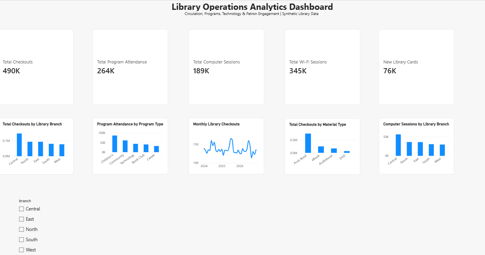

# Library Operations Analytics

## Project Overview

This project analyzes a synthetic library operations dataset containing 20,000 records to identify patterns in circulation, programming, technology usage, patron engagement, and branch activity.

The project demonstrates an end-to-end data analytics workflow using Python, SQL, and Power BI.

## Tools Used

- Python
- Pandas
- Matplotlib
- Jupyter Notebook
- MySQL
- DBeaver
- Power BI
- GitHub

## Analysis Performed

The analysis examined:

- Checkouts by library branch
- Program attendance by program type
- Checkouts by material type
- Monthly checkout trends
- Computer sessions by branch
- Wi-Fi sessions by branch
- New library cards by branch
- Reference questions by branch
- Checkouts by patron age group
- High-activity records by branch
- Correlations between library activity measures

## Key Findings

- Central Library had the highest overall activity across several service measures.
- Total circulation was approximately 490,000 checkouts.
- Children's programs generated the highest total program attendance.
- Print books accounted for the largest number of material checkouts.
- Adults had the highest total checkouts among patron age groups.
- Central Library recorded the highest computer and Wi-Fi usage.
- Most high-activity records occurred at Central Library.
- Correlations among the major activity measures were generally weak, suggesting that circulation, technology use, programming, and other library services represent different aspects of patron engagement.

## Power BI Dashboard

The interactive Power BI dashboard provides an overview of circulation, programming, technology usage, and patron engagement. A branch slicer allows results to be filtered by individual library location.

## Project Files

- `Synthetic_Library_Operations_Analytics.csv` — Synthetic dataset used for the analysis
- Jupyter Notebook — Python exploratory data analysis and visualizations
- SQL file — MySQL queries used to analyze and validate the data
- `Library_Operations_Analytics_Dashboard.pbix` — Interactive Power BI dashboard
- `dashboard_screenshot.png` — Dashboard preview

## Data Privacy

This project uses synthetic data created for educational and portfolio purposes. It does not contain actual library patron information or confidential library data.
